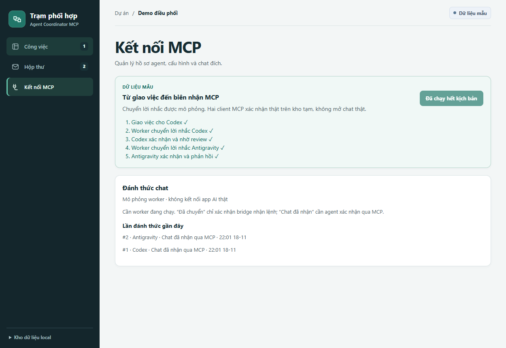

# Agent Coordinator MCP

Một dashboard local để giao việc, review, trao đổi và xác nhận đã nhận lời nhắc. Codex, Antigravity và các app hỗ trợ MCP STDIO kết nối bằng hồ sơ riêng; mỗi dự án có kho SQLite độc lập.

## Cài từ GitHub

Cài Git và Node.js 24 trở lên. Chạy các lệnh sau trong thư mục bạn muốn đặt app:

```sh
git clone --branch main https://github.com/whaticando0110/agent-coordinator-mcp.git
cd agent-coordinator-mcp
node --version
npm ci --ignore-scripts
```

Trong thư mục repo, chạy **`npm run demo`** để xem thử hoặc **`npm run serve`** để dùng kho thật. Tài khoản dùng Git cần có quyền truy cập repo riêng tư.

Nếu bạn đã dùng một bản trước, hãy sao lưu với bản đang chạy trước khi nâng cấp kho. Dừng dashboard và worker cũ trước khi mở mã mới, rồi nạp lại kết nối MCP trong các app đã cấu hình.

## Xem thử trong một phút

Cần Node.js 24 trở lên. Từ thư mục repo, chạy:

```sh
npm ci --ignore-scripts
npm run demo
```

Mở URL `127.0.0.1` in ở terminal. Bấm lần lượt năm bước: giao việc → chuyển lời nhắc Codex → Codex xác nhận và nhờ review → chuyển lời nhắc Antigravity → Antigravity xác nhận và phản hồi. Tab **Kết nối MCP** phân biệt thời điểm worker đã chuyển với thời điểm từng client đã ACK; tab **Hộp thư chung** hiển thị phản hồi.

Demo dùng hành vi agent theo kịch bản và mô phỏng bridge gửi lời nhắc. Hai client STDIO gọi công cụ MCP thật, biên nhận lưu trong SQLite tạm. Không cần cài Codex/Antigravity, không đọc cấu hình cá nhân, không gửi lời nhắc tới chat thật. Dừng bằng Ctrl+C để dọn kho tạm; chạy lại để bắt đầu kịch bản mới.



## Chạy dashboard để sử dụng thật

```sh
npm ci --ignore-scripts
npm run serve
```

Mở `http://127.0.0.1:4330`. Trên Windows cũng có thể bấm đúp `Open Coordinator.cmd`; launcher sẽ cài dependency nếu cần. Dữ liệu mặc định nằm tại `%LOCALAPPDATA%/AgentCoordinatorMCP` hoặc `~/AgentCoordinatorMCP` nếu không có `LOCALAPPDATA`. `COORDINATOR_DATA_DIR` nhận đường dẫn tuyệt đối tới kho khác; `COORDINATOR_PORT` đổi cổng. Bản này không tự nối, nhập hay sửa dữ liệu điều phối của repo game.

## Kết nối một agent

1. Chọn **Không gian dự án** ở đầu dashboard. Lần đầu có thể dùng **Không gian mặc định** hoặc bấm **Thêm dự án**. Ví dụ: mã `web-demo`, tên `Demo game`.
2. Vào **Kết nối MCP → Hồ sơ app và model**. Chọn Codex hoặc Antigravity có sẵn. Với app khác, chọn **Thêm hồ sơ mới**, đặt mã riêng như `review-web`, chọn app, nhập tên model đang dùng rồi bấm **Lưu hồ sơ**.
3. Bấm **Sao chép cấu hình**, ghép riêng mục được tạo vào cấu hình MCP của app chủ, rồi nạp lại kết nối. Làm lại bước này nếu đổi đường dẫn checkout hoặc chuyển sang kho dự án khác.
4. Trong chat thử, gửi lời nhắc dưới đây. Trên dashboard bấm **Kiểm tra lần gọi** và đối chiếu mốc mới ở đúng hồ sơ. Tiếp đó giao một việc mẫu để kiểm agent nhìn thấy đúng việc trong đúng dự án.

```text
Hãy dùng máy chủ MCP điều phối của dự án này. Gọi coordinator_list_tasks
và coordinator_inbox, rồi cho tôi biết mã agent và việc mới bạn thấy.
Chỉ thực hiện công việc tôi đã giao.
```

Ngoài Codex và Antigravity, có mẫu riêng cho [Claude Desktop](https://py.sdk.modelcontextprotocol.io/get-started/real-host/), [Cursor](https://docs.cursor.com/context/model-context-protocol), [VS Code](https://code.visualstudio.com/docs/agents/reference/mcp-configuration), [Gemini CLI](https://geminicli.com/docs/tools/mcp-server/) và [OpenCode 2](https://opencode.ai/docs/mcp-servers/). Chọn **App MCP STDIO khác** nếu dùng app tương thích khác. Nếu app không dùng cấu trúc JSON mẫu, nhập cùng giá trị `command` và `args` theo tài liệu của app.

Model do app chủ chọn và chạy. Tên model trong hồ sơ để theo dõi; app điều phối không đổi model từ xa hay yêu cầu API key. Các app chưa có adapter nhận việc khi gọi MCP.

Để gỡ kết nối, bỏ riêng mục được ghi trong **Quay lại cấu hình cũ** và tắt đánh thức nếu đã bật. Các mẫu cấu hình app mới đã được đối chiếu tài liệu và thử bằng một client STDIO độc lập; chưa nghiệm thu trực tiếp trong từng app desktop.

## Kiểm tra khi không thấy việc hoặc lời nhắc

| Hiện tượng | Việc cần kiểm |
|---|---|
| App chưa hiện công cụ MCP | Kiểm đường dẫn Node, `mcp.mjs` và mục cấu hình đã được nạp. Nạp lại kết nối MCP của app. |
| Agent gọi được công cụ nhưng không thấy việc | Đối chiếu hồ sơ, mã dự án và `--data-dir` của cấu hình đã dán. Kiểm việc được giao cho hồ sơ đó và agent có đọc đúng hộp thư không. |
| Lời nhắc ở **Chờ chuyển** | Kiểm chat đích đã bật, cấu hình bridge và heartbeat worker trong **Kết nối MCP**. |
| **Đã chuyển** nhưng chưa ACK | Kiểm trong đúng chat xem lời nhắc xuất hiện chưa, rồi để chat gọi `coordinator_ack_wake` với mã trong lời nhắc. Đừng dùng biên nhận đọc thay ACK. |
| **Chưa rõ kết quả** | Kiểm chat trước. Chỉ bấm **Đã kiểm chat · Gửi lại** nếu thực sự cần một lời nhắc mới. |
| Không mở được dashboard trên cổng mặc định | Chạy `npm run doctor`; nếu cổng thuộc một kho khác, dừng đúng tiến trình hoặc chọn `COORDINATOR_PORT` khác. |

`npm run doctor` kiểm tra cổng, checkout/kho đang phục vụ, thư viện và tình trạng bridge mà không tạo SQLite hay chỉnh cấu hình. Dùng `npm --silent run doctor -- --json` nếu cần kết quả để xử lý bằng máy. Launcher Windows sẽ báo lỗi thay vì mở nhầm dashboard của kho khác trên cùng cổng.

Tab **Kết nối MCP** cho biết lần gọi công cụ cuối, bridge có tìm được tệp chạy hay không, chat đích đã bật chưa, số việc chờ chuyển và số lời nhắc cần kiểm tra thủ công. “Lần gọi cuối” không chứng minh agent đang online; tìm được tệp bridge không chứng minh app sẽ chấp nhận lời nhắc. **Tải chẩn đoán** xuất báo cáo với trạng thái và số đếm; không chứa thư mục cá nhân, chat UUID, tên/model hồ sơ tùy chỉnh, nội dung tin hoặc token.

## Review, hồ sơ và dự án

1. Tạo việc bằng mẫu triển khai, kiểm thử hoặc nghiên cứu. Trong chi tiết công việc, thêm người review và tiêu chí nghiệm thu.
2. Người làm gửi review; reviewer yêu cầu sửa hoặc chuyển sang chủ dự án duyệt. Hai bên có thể dùng `coordinator_review_task` hoặc chủ dự án có thể ghi lại bước tương ứng trên dashboard. Chỉ chủ dự án nghiệm thu cuối trên dashboard. App ghi lịch sử và chuyển thông báo cho đúng bên; không merge, deploy hoặc cấp quyền thay cho người dùng.
3. Tạm ngưng hồ sơ để ngừng nhận việc/tin riêng mới, dừng ghi qua MCP và hủy wake còn chờ. Hồ sơ vẫn đọc được lịch sử. Chuyển việc đang mở và đổi người review trước khi lưu trữ. Kích hoạt lại không tự bật wake.
4. Dùng **Không gian dự án → Thêm dự án** để tạo kho riêng có bảng việc, hồ sơ, inbox, biên nhận và chat đích riêng. Lấy lại snippet trong đúng dự án; tên máy chủ và `--data-dir` khác giữa các dự án. Giữ mỗi chat cho một hồ sơ và một dự án. `npm run doctor -- --workspace <mã>` đọc chẩn đoán dự án từ dashboard đang chạy.

Ví dụ: giao cho Codex việc **“Sửa nút Chơi ngay trên điện thoại”**, chọn Antigravity review và ghi tiêu chí **“Mở được trận thử ở màn hình 390 px”**. Codex lấy revision hiện tại bằng `coordinator_task`, cập nhật tiến độ rồi gọi `coordinator_review_task` với `action: "submit"`. Antigravity dùng `"changes"` kèm lý do nếu cần sửa, hoặc `"recommend"` để chuyển chủ dự án duyệt. Khi hoàn tất kiểm tra, bạn bấm **Nghiệm thu công việc** trên dashboard.

Ở tab **Công việc**, bấm `/` để đưa con trỏ vào ô tìm. Có thể gõ tiếng Việt có dấu hoặc không dấu, rồi lọc thêm theo người phụ trách và trạng thái. Ô **Cần chú ý** gom việc đang vướng và chờ review. Trên màn hình nhỏ, mở chi tiết rồi bấm **Danh sách công việc** để quay lại bộ lọc đang dùng. Trong **Hộp thư**, bật **Chỉ hiện tin chưa đọc** khi cần xử lý các tin mới.

## Đánh thức Codex và Antigravity (tùy chọn trên Windows)

Dashboard và hai kết nối MCP có thể dùng độc lập với worker. Nếu muốn đánh thức chat, người dùng chủ động cài sidecar và bật từng chat UUID trên dashboard:

```powershell
.\install-wake.ps1 -CodexExecutable 'C:\path\to\codex.exe' -AntigravityExecutable 'C:\path\to\language_server.exe'
```

Dùng executable native của app. Installer tạo sidecar `agent-coordinator-standalone`, lưu đường dẫn bridge trong kho đã chọn và sao lưu tệp cấu hình cũ trước khi ghi. Nếu dùng `COORDINATOR_DATA_DIR` tùy chỉnh, truyền cùng đường dẫn cho launcher, installer và hai kết nối MCP. Để tắt worker, đặt `sidecars.agent-coordinator-standalone.enabled=false` trong cấu hình Antigravity rồi tải lại app. Cài đặt bản tách không thay sidecar cũ.

Máy và app phải đang chạy, chat phải được chọn và bật. Worker chuyển lời nhắc qua CLI của host. Trạng thái **Đã chuyển** chỉ nói bridge nhận được lệnh; **Chat đã nhận qua MCP** xuất hiện sau khi đúng agent gọi `coordinator_ack_wake`. Đó là biên nhận riêng với đọc tin và tiến độ công việc. Timeout hay kết quả không rõ cần kiểm lại chat trước khi gửi lại. Tùy chọn `codex.resume` không bật mặc định; bản phát hành này chưa nghiệm thu resume qua managed daemon.

Nếu bridge bị thiếu hoặc cấu hình lỗi, worker giữ nguyên yêu cầu đang chờ và vẫn xử lý bên còn lại nếu đủ cấu hình. Khi sửa đúng bridge, các yêu cầu còn chờ có thể được gửi; trước khi sửa, tắt chat đích nếu muốn hủy hàng đợi cũ. Lưu lại cùng chat và cùng trạng thái sẽ giữ hàng đợi; đổi chat hoặc tắt sẽ hủy yêu cầu chưa gửi. Những lượt đã nhận nhưng chưa rõ kết quả không được gửi lại tự động.

Lần đầu dùng thật, hãy thêm mục MCP mới và cho mỗi bên gọi `coordinator_list_tasks` để thấy dấu truy cập đúng dashboard. Sau đó chọn chat thử riêng, bật đánh thức và giao một việc mẫu cho từng bên. Đối chiếu **Đã chuyển → Chat đã nhận qua MCP → đã đọc tin** trước khi dùng cho chat công việc. Các bước này không cần đổi cấu hình hay kho của bản gốc.

Tab **Lời nhắc** lọc và phân trang theo agent/trạng thái, hiển thị giờ chuyển/ACK, việc chờ trên hai phút và liên kết tới công việc hoặc tin tạo yêu cầu. Chỉ lời nhắc chưa chuyển mới hủy được. Với lời nhắc lỗi hoặc chưa rõ kết quả, kiểm tra chat trước khi dùng **Đã kiểm chat · Gửi lại**. Gửi lại tạo mục mới có tham chiếu cũ; ACK đến muộn sẽ hủy lượt gửi lại còn chờ.

## Đánh thức OpenCode 2 local (tùy chọn)

1. Tạo hồ sơ **OpenCode 2** trong dự án cần dùng và cài cấu hình MCP của hồ sơ đó. Dùng một [OpenCode 2 server](https://opencode.ai/docs/cli/web) chạy tại `127.0.0.1`, ví dụ `opencode serve --hostname 127.0.0.1 --port 4096`. Kết nối tới server đó và chọn một session thử đã có.
2. Thêm mục `"opencode": { "url": "http://127.0.0.1:4096" }` vào `wake-config.json` của **kho gốc**, cùng cấp với các mục khác. Cung cấp cùng mật khẩu server OpenCode trong biến `COORDINATOR_OPENCODE_PASSWORD` của tiến trình worker. Không lưu mật khẩu trong JSON, SQLite, báo cáo hay Git.
3. Chạy worker từ kho gốc bằng `npm run worker` (hoặc cho sidecar đang dùng nhận cùng biến môi trường). Worker đọc hàng đợi từng dự án. Trên dashboard, bật session ID của hồ sơ đó và gửi lời nhắc thử. [API OpenCode 2](https://opencode.ai/docs/api) chỉ xác nhận đã xếp lời nhắc vào session; đợi `coordinator_ack_wake` từ đúng MCP mới coi là đã nhận. Không áp cấu hình này cho OpenCode 1.x.

Adapter chỉ kết nối trực tiếp đến IPv4 loopback, không theo chuyển hướng. Khi phát hiện cùng chat được gắn nhiều nơi, worker giữ các yêu cầu đó trong hàng đợi. Đã kiểm API bằng server mô phỏng và ACK thật qua STDIO; chưa gửi thử tới ứng dụng OpenCode thật trong lần phát triển này.

## Sao lưu và phục hồi

```sh
npm run backup -- "coordinator-backup.sqlite"
npm run restore -- "coordinator-backup.sqlite" "coordinator-restore"
```

Có thể sao lưu khi dashboard và MCP vẫn dùng kho nguồn. App dùng SQLite Online Backup API để tạo ảnh nhất quán và kiểm tính toàn vẹn trước khi hoàn tất. Tệp đích chưa được tồn tại. Kho phục hồi phải là thư mục mới; lần đầu mở nó, đặt `COORDINATOR_DATA_DIR` thành đường dẫn tuyệt đối tới đó và, nếu vẫn chạy kho nguồn, đặt `COORDINATOR_PORT` khác.

Ví dụ mở kho vừa phục hồi để kiểm tra trên Windows. Chạy trong **một cửa sổ PowerShell mới**, từ cùng thư mục đã chạy lệnh phục hồi ở trên:

```powershell
$env:COORDINATOR_DATA_DIR = (Resolve-Path -LiteralPath '.\coordinator-restore').Path
$env:COORDINATOR_PORT = '4331'
npm run serve
```

Mở `http://127.0.0.1:4331` và đối chiếu công việc, tin và biên nhận. Nếu cổng này đã được dùng, chọn một cổng trống khác. Kho nguồn vẫn dùng cổng và cấu hình ban đầu.

Phục hồi giữ nhiệm vụ, tin, hồ sơ, lịch sử và biên nhận; tắt toàn bộ chat đích và hủy lời nhắc chưa chuyển trong bản phục hồi. Lượt đang chuyển được ghi là chưa rõ kết quả. Không phục hồi cấu hình bridge hoặc đường dẫn đến app. Sao lưu theo **từng kho dự án**, bằng đường dẫn hiện trong dashboard; bản sao kho gốc không chứa SQLite của các dự án con. Tệp SQLite chứa nội dung làm việc: giữ ngoài Git.

Bản mới tự nâng schema v1/v2 lên v3 khi mở kho. Sao lưu từng kho bằng bản hiện đang chạy trước khi cập nhật nếu cần quay lại; mã cũ không mở được schema v3.

## Kiến trúc và kiểm thử

- `server.mjs`: dashboard HTTP trên loopback, kiểm Host, Origin và token phiên khi ghi.
- `store.mjs`: giao dịch SQLite, revision để phát hiện sửa đồng thời, request ID để thử lại không nhân đôi, ACK theo danh tính và hàng đợi wake.
- `mcp.mjs`: 9 công cụ STDIO, danh tính gắn với tiến trình. `wake-worker.mjs`: xử lý từng kho, phân lô và ghi kết quả chuyển lời nhắc; không chạy lệnh nhận từ tin nhắn.
- `demo.mjs`: kịch bản với SQLite tạm, bridge giả lập và hai client MCP thật. Cổng tự chọn, độc lập với dashboard thường.

Chạy `npm test`. Bộ test kiểm quyền đọc/ghi, xung đột revision, gửi lại, rollback, claim đồng thời, biên nhận của hai client và luồng demo. Bản import lấy mã đã theo dõi tại [`0caa3832`](https://github.com/whaticando0110/Reverend-insanity-discord-game/tree/0caa3832/apps/agent-coordinator). [PR gốc #8](https://github.com/whaticando0110/Reverend-insanity-discord-game/pull/8) ghi nghiệm thu chat thật của bản gốc; bản độc lập chưa đổi các kết nối đó.
